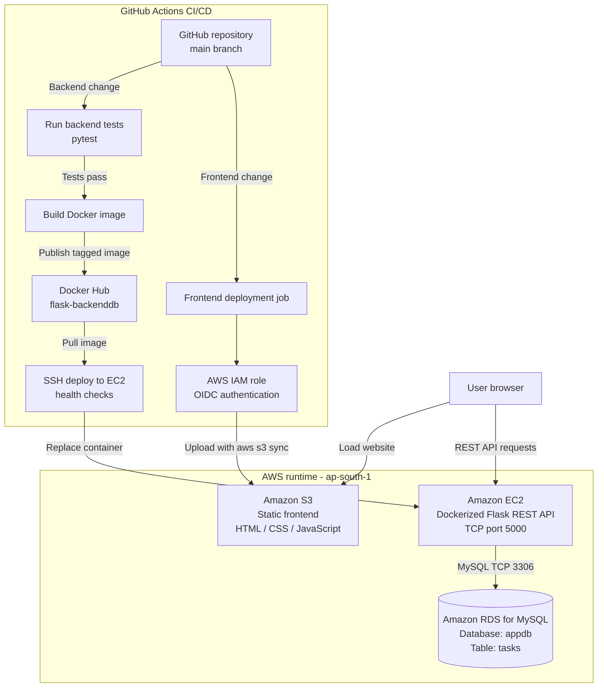

# AWS Task Manager — End-to-End DevOps Project

A task-management web application deployed on AWS. The project demonstrates static website hosting, a containerized Flask API, persistent MySQL storage, automated testing, Docker image publishing, and GitHub Actions deployments.

> **Repository:** `Bmanasa-2015/Aws-task-manger-devops`  
> **Docker image:** `manasabolla/flask-backenddb`  
> **AWS Region:** Asia Pacific (Mumbai), `ap-south-1`

## 1. Project goals

- Host the frontend with Amazon S3 static website hosting.
- Run a Python Flask REST API in Docker on an Amazon EC2 instance.
- Store tasks persistently in Amazon RDS for MySQL.
- Test backend changes automatically with GitHub Actions.
- Build and publish versioned Docker images to Docker Hub.
- Deploy backend updates to EC2 after tests and image publishing succeed.
- Upload frontend changes to S3 automatically using GitHub Actions and AWS OIDC, without long-lived AWS access keys.

## 2. Architecture



### Request flow

1. A user's browser loads `index.html`, `style.css`, and `app.js` from the S3 static website.
2. `frontend/app.js` sends requests to the Flask API using the configured EC2 public/Elastic IP and port `5000`.
3. Flask validates each request and reads or writes tasks in the `appdb.tasks` table in RDS.
4. RDS stores the tasks, so they remain available after the Docker container is restarted or redeployed.

### CI/CD flow

**Backend deployment** — a push to `main` triggers the backend workflow:

1. Install backend test dependencies.
2. Run `pytest` tests.
3. Check that the RDS integration is present.
4. Build the Docker image and push `latest` plus a commit-specific tag to Docker Hub.
5. Connect to EC2 over SSH and pull the commit-specific image.
6. Keep the previous container as a rollback option, start the new container with `/opt/task-manager/backend.env`, and check `/health` and `/api/tasks`.
7. If the health check fails, the workflow attempts to restore the previous container.

**Frontend deployment** — a change under `frontend/` on `main` (or a manual workflow run) triggers the frontend workflow:

1. GitHub Actions obtains short-lived AWS credentials by assuming an IAM role through OIDC.
2. It runs `aws s3 sync frontend/ s3://<bucket-name>/` to upload the frontend files.
3. No long-lived AWS access keys are needed in GitHub secrets.

## 3. AWS components

| Component | Purpose | Important configuration |
|---|---|---|
| Amazon S3 | Static website hosting | Contains `index.html`, `style.css`, and `app.js` |
| Amazon EC2 | Hosts the Dockerized Flask API | Container exposes port `5000` |
| Docker | Packages and runs the backend | Image: `manasabolla/flask-backenddb` |
| Amazon RDS for MySQL | Persistent task storage | Database: `appdb`; table: `tasks` |
| AWS IAM OIDC provider and role | Allows GitHub Actions to deploy frontend to S3 | Trust policy should be restricted to this repository and intended branch |
| Elastic IP (recommended) | Stable EC2 public IP for the frontend API URL | Update `frontend/app.js` if the API IP changes |

## 4. Repository layout

```text
Aws-task-manger-devops/
├── .github/
│   └── workflows/
│       ├── ci.yaml                 # Test, Docker publish, backend deployment
│       └── deploy-frontend.yml     # OIDC authentication and S3 upload
├── backend/
│   ├── app.py                      # Flask API and RDS integration
│   ├── Dockerfile                  # Backend Docker image definition
│   ├── requirements.txt            # Runtime dependencies
│   ├── requirements-dev.txt        # Runtime dependencies plus pytest
│   └── test_app.py                 # API tests
└── frontend/
    ├── index.html                  # Web page
    ├── style.css                   # Styling
    └── app.js                      # Calls the Flask API
```

## 5. Backend API

Base URL example:

```text
http://<EC2_ELASTIC_IP>:5000
```

| Method | Endpoint | Purpose |
|---|---|---|
| `GET` | `/` | API welcome/status message |
| `GET` | `/health` | Health check |
| `GET` | `/api/tasks` | List tasks |
| `POST` | `/api/tasks` | Create a task |
| `PUT` | `/api/tasks/<id>` | Update a task title and/or completion status |
| `DELETE` | `/api/tasks/<id>` | Delete a task |

Example create request:

```bash
curl -i -X POST "http://<EC2_ELASTIC_IP>:5000/api/tasks" \
  -H "Content-Type: application/json" \
  -d '{"title":"Learn GitHub Actions"}'
```

Example response:

```json
{
  "id": 1,
  "title": "Learn GitHub Actions",
  "completed": false
}
```

The exact task ID depends on the current database contents.

## 6. Database schema

The RDS database is named `appdb`. The API expects a table named `tasks` with this structure:

```sql
CREATE TABLE IF NOT EXISTS tasks (
    id INT AUTO_INCREMENT PRIMARY KEY,
    title VARCHAR(200) NOT NULL,
    completed BOOLEAN NOT NULL DEFAULT FALSE
);
```

The backend uses parameterized SQL statements for task values. When `DB_HOST` is set, the API uses MySQL. When it is absent, the application uses in-memory storage so the test suite can run without a live RDS instance.

## 7. Environment configuration on EC2

The backend container reads environment variables from this file on EC2:

```text
/opt/task-manager/backend.env
```

It should contain the following keys with your own values (do **not** commit this file to GitHub):

```dotenv
DB_HOST=<your-rds-endpoint>
DB_PORT=3306
DB_NAME=appdb
DB_USER=<your-rds-username>
DB_PASSWORD=<your-rds-password>
```

Protect the file so only the appropriate administrator/root account can read it. For example, on an Amazon Linux EC2 instance:

```bash
sudo chown root:root /opt/task-manager/backend.env
sudo chmod 600 /opt/task-manager/backend.env
```

The deployment workflow passes this file to Docker with `--env-file`; the password is not stored in the repository or frontend JavaScript.

## 8. GitHub Actions configuration

### Required repository secrets

Add these under **GitHub repository → Settings → Secrets and variables → Actions**. Secret values are not included in this README.

| Secret | Used by | Value |
|---|---|---|
| `DOCKERHUB_USERNAME` | Backend publish workflow | Docker Hub username |
| `DOCKERHUB_TOKEN` | Backend publish workflow | Docker Hub access token with Read & Write permissions |
| `EC2_HOST` | Backend deployment workflow | Current EC2 public IP or Elastic IP |
| `EC2_USER` | Backend deployment workflow | Usually `ec2-user` for Amazon Linux |
| `EC2_SSH_KEY` | Backend deployment workflow | Full PEM private key contents |
| `AWS_ROLE_TO_ASSUME` | Frontend deployment workflow | ARN of the restricted IAM role for S3 deployment |
| `S3_BUCKET_NAME` | Frontend deployment workflow | Exact S3 bucket name, without `s3://` |

### Workflow triggers

- `.github/workflows/ci.yaml`: tests on pushes and pull requests to `main`. On a push to `main`, after tests pass, it publishes the backend image and deploys it to EC2.
- `.github/workflows/deploy-frontend.yml`: uploads frontend files when `frontend/**` changes on `main`; it also supports manual execution with `workflow_dispatch`.

### AWS OIDC requirements for frontend deployment

- The GitHub OIDC provider must exist in IAM: `token.actions.githubusercontent.com` with audience `sts.amazonaws.com`.
- The frontend workflow needs the `id-token: write` permission.
- The role trust policy must match the repository's actual OIDC subject format and restrict access to the intended repository and branch.
- The role's permissions should be limited to the required S3 bucket. This workflow needs `s3:ListBucket` and `s3:PutObject`. It does not use `--delete`, so `s3:DeleteObject` is not required and can be removed from the role policy for least privilege.
- Do not broaden the trust policy to all repositories or all branches just to resolve an OIDC error.

## 9. Complete setup and deployment process

### A. Prepare RDS

1. Create an RDS MySQL instance in the same region as the application (this project uses `ap-south-1`).
2. Create or confirm database `appdb` and the `tasks` table.
3. Configure the RDS security group so inbound MySQL TCP `3306` is allowed from the EC2 instance's security group, not from all public IPs.
4. Keep the endpoint, database name, username, and password available for EC2 configuration only.

### B. Prepare EC2 and Docker

1. Launch an EC2 instance and install Docker.
2. Configure the instance security group for the required access: application TCP `5000` for the current browser-to-API design, and SSH `22` for the approved deployment method.
3. Store database settings in `/opt/task-manager/backend.env` and restrict file permissions.
4. Ensure the EC2 user used by GitHub Actions can run the Docker commands required by the workflow (the workflow uses `sudo docker`).
5. Confirm the RDS security group allows the EC2 security group on port `3306`.

### C. Prepare S3 frontend hosting

1. Create the S3 bucket and enable static website hosting.
2. Upload `index.html`, `style.css`, and `app.js` at the website root.
3. Configure the bucket policy and public-access settings appropriate for a public static website.
4. Set the `API_URL` near the top of `frontend/app.js` to `http://<EC2_ELASTIC_IP>:5000/api/tasks` (use the actual public/Elastic IP; do not use `localhost`).
5. Run the frontend deployment workflow after configuring the S3 bucket secret and IAM OIDC role.

### D. Configure Docker Hub and backend GitHub Actions

1. Create a Docker Hub access token with Read & Write access.
2. Add the Docker Hub, EC2 host, SSH username, and PEM key as repository secrets.
3. Confirm the backend workflow file is in `.github/workflows/ci.yaml`.
4. Push a backend change to `main`.
5. Open the Actions tab and check that `Test Backend`, `Build and Push Docker Image`, and `Deploy to EC2` all succeed.

### E. Configure frontend GitHub Actions

1. Create an IAM OIDC provider for GitHub Actions if it does not already exist.
2. Create an IAM role with a trust policy restricted to this repository and branch.
3. Give the role permission to list and upload to the frontend S3 bucket only.
4. Add `AWS_ROLE_TO_ASSUME` and `S3_BUCKET_NAME` as repository secrets.
5. Commit a change under `frontend/` to `main` and monitor the `Deploy Frontend to S3` workflow.
6. Refresh the S3 website (Ctrl+F5) and verify the updated page and tasks.

## 10. Testing

GitHub Actions runs the backend tests with Python 3.12 and `pytest`. If you want to run the tests on a computer without Python installed, and Docker Desktop is available, run this from the project root in PowerShell:

```powershell
docker run --rm -v "${PWD}:/work" -w /work python:3.12-slim sh -c "pip install --quiet --root-user-action=ignore -r backend/requirements-dev.txt && python -m pytest backend/test_app.py -v"
```

The application currently includes tests for the health endpoint, task listing, task creation, invalid titles, updating, deleting, and missing tasks.

## 11. Troubleshooting

### Frontend loads but tasks do not appear

- Check the browser Developer Tools Console and Network tabs.
- Confirm `frontend/app.js` has the correct API URL, including `:5000` with no extra slash before the colon.
- Do not use `localhost` in the deployed frontend.
- Test the API directly: `http://<EC2_ELASTIC_IP>:5000/health` and `http://<EC2_ELASTIC_IP>:5000/api/tasks`.
- Check the EC2 security group allows the required API port and confirm the backend container is running.

### API returns an error or HTTP 503

- Check the backend container logs: `sudo docker logs --tail 100 flask-backenddb-rds`.
- Verify `/opt/task-manager/backend.env` has the correct endpoint and `DB_NAME=appdb`.
- Check RDS status and ensure its security group permits inbound TCP `3306` from EC2.
- Verify the table is named `tasks` and its columns match the schema above.

### GitHub deployment cannot assume the AWS role

- Confirm `AWS_ROLE_TO_ASSUME` contains the role ARN, not the OIDC provider ARN.
- Confirm the OIDC provider audience is `sts.amazonaws.com`.
- Check that the IAM trust policy's `aud` and `sub` exactly match the GitHub run's actual claims.
- Check that the role has permission for the specific S3 bucket.

### Backend SSH deployment fails

- Confirm `EC2_HOST`, `EC2_USER`, and `EC2_SSH_KEY` are correct.
- Check the private key is the full PEM text and that the EC2 instance still accepts the matching key.
- Confirm the EC2 security group and network allow SSH from the GitHub-hosted runner. Do not solve this by casually opening SSH to the entire internet; consider a more controlled deployment method for production.

## 12. Security and cost notes

- The current simple demo serves the S3 website and EC2 API over HTTP. Use HTTPS and a stronger edge/API security design before handling sensitive user data or using the project in production.
- Keep RDS private and restrict TCP `3306` to the EC2 security group.
- Never commit `.pem` files, `backend.env`, database passwords, Docker tokens, or other credentials.
- Use a dedicated least-privilege database user instead of the RDS master user for a production application.
- The EC2 SSH deployment uses a private key in GitHub Secrets. Restrict repository access and rotate the key/token if exposed.
- Monitor AWS Billing and Cost Management. EC2, RDS, storage, data transfer, and public IPv4/Elastic IP usage may incur charges. Budget alerts notify you but are not a hard spending cap.
- Keep a working rollback container until the newly deployed image is verified; clean up old rollback containers when they are no longer needed.

## 13. Project outcome

This project demonstrates the complete path from code commit to a live application: automated backend testing, container image publishing, backend deployment with health checks, frontend publishing through OIDC, and task persistence in RDS.
